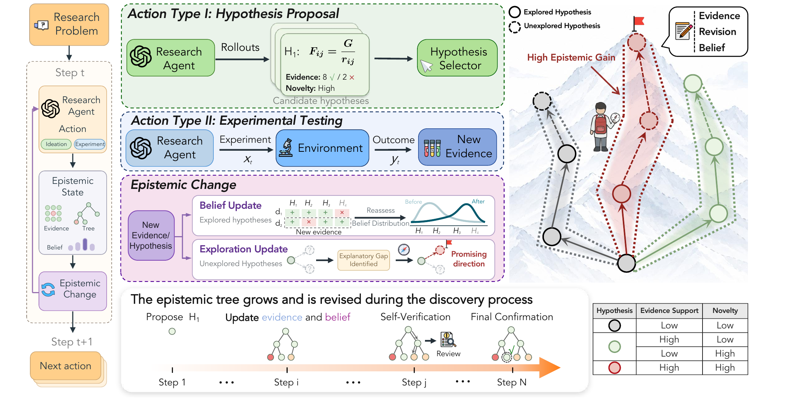

<h1 align="center">
  Steering Automated Scientific Discovery via Audited Epistemic Exploration
</h1>

<p align="center">
  📄 <a href="https://arxiv.org/abs/2611.25214"><strong>Paper</strong></a>
</p>

<p align="center">
  <a href="https://yu-fangxu.github.io/">Fangxu Yu</a><sup>1</sup>,
  <a href="https://ft2023.github.io/taofeng.github.io/">Tao Feng</a><sup>2</sup>,
  <a href="https://xuyingning.com/">Xuying Ning</a><sup>2</sup>,
  <a href="https://openreview.net/profile?id=~Haolin_Yang10">Haolin Yang</a><sup>3</sup>,
  <a href="https://cs.stanford.edu/~jiaxuan/">Jiaxuan You</a><sup>2</sup>,
  <a href="https://tianyizhou.github.io/">Tianyi Zhou</a><sup>3</sup>
</p>

<p align="center">
  <sup>1</sup>University of Maryland, College Park &nbsp;
  <sup>2</sup>University of Illinois Urbana-Champaign &nbsp;
  <sup>3</sup>Mohamed bin Zayed University of Artificial Intelligence
</p>



## 🔥 Overview

**Epistemic Compass (EpiCompass)** is a plug-and-play scaffold that gives an LLM research agent an explicit, continually audited **epistemic state** while it discovers a hidden law through its own experiments.

Research agents update what they believe implicitly: they keep hypotheses their own experiments contradict, explore a narrow hypothesis space, and commit before the evidence separates the alternatives. EpiCompass keeps an **epistemic tree** that links the agent's hypotheses, the evidence each of its experiments provides for or against them, its beliefs, and the revisions between hypotheses. After every experiment or hypothesis it runs two updates: a **belief update** reassesses all explored hypotheses against the accumulated evidence, and an **exploration update** turns conflicts and unexplained observations into explicit directions. The agent proposes hypotheses by sampling several candidates and **selecting by anticipated epistemic gain** (evidential support and the direction a candidate opens), and before its answer is scored, **epistemically grounded self-verification** shows it the complete tree. The component uses the agent's own backbone for every judgment, never sees the ground truth, and changes neither model parameters nor the experiment budget.

## 🚀 Key Features

- 🌳 **Epistemic tree**: every hypothesis the agent writes becomes a node with its belief and a support / conflict / neutral label for each of the agent's experiments; each edge records which experiments a revision fixes or breaks.
- 🔄 **Belief and exploration updates**: hypotheses are replayed on all accumulated experiments, beliefs are restated from this evidence, the main hypothesis changes when another one is better supported, and open directions (unexplained experiments, inputs never varied, alternatives no experiment separates) are reported.
- 🧭 **Epistemic-gain selection**: at a hypothesis step, K candidates are sampled and the one that best combines evidential support with a promising new direction replaces the proposal.
- ✅ **Self-verification**: at the first submission the agent sees the complete tree and may revise, experiment further within its budget, or confirm; a revision that is worse on its own data is flagged.
- 🔌 **Plug-and-play**: one session object wraps an unchanged benchmark agent loop; adapters are provided for DiscoverPhysics, ActiveSciBench-Chem, and NewtonBench, together with ReAct, Hypothesis Search, and Popper baselines on the same harness.

## 🖥️ Installation

The core package depends only on the Python standard library and NumPy; each benchmark brings its own environment.

```bash
git clone https://github.com/tianyi-lab/EpiCompass.git
cd EpiCompass
pip install -r requirements.txt        # into the environment of the benchmark you run
```

EpiCompass talks to any **OpenAI-compatible chat-completions endpoint** (Gemini, OpenAI, or a local vLLM server). The agent and the component use the same backbone:

```bash
export EPIC_API_KEY=...                # or EPIC_API_KEYS=key1,key2 (rotated); GEMINI_API_KEY also works
export EPIC_BASE_URL=https://generativelanguage.googleapis.com/v1beta/openai     # the default
# for a local vLLM server:  export EPIC_BASE_URL=http://localhost:8000/v1 EPIC_API_KEY=EMPTY
```

## 📥 Prepare the Benchmarks

Clone the benchmarks next to this repository and set up their environments as described in their own READMEs:

| Benchmark | Repository | Used from it |
|---|---|---|
| DiscoverPhysics | [SampsonML/DiscoverPhysics](https://github.com/SampsonML/DiscoverPhysics) | `ScienceAgent` (agent loop, simulator, evaluator, explanation judge) |
| ActiveSciBench-Chem | [scientific-discovery/LLM-AutoSciLab](https://github.com/scientific-discovery/LLM-AutoSciLab) | `autoscilab.oracle.chembench` (oracle and evaluation), task manifest |
| NewtonBench | [HKUST-KnowComp/NewtonBench](https://github.com/HKUST-KnowComp/NewtonBench) | `modules/` (environments, evaluators), `utils/vanilla_agent.py` (prompts and parsers) |

No file of a benchmark is modified: the run scripts import the benchmark's own code and wrap its agent loop.

## 🎯 Run EpiCompass

Every script takes `--method`: `epicompass` (default), `react` (the unchanged agent loop), `hsearch` (Hypothesis Search), or `popper` (Popper). Results are written as one JSON per run, with the conversation, the submitted law, the benchmark's evaluation, and the epistemic-state record (`epic_summary`, `epic_events`, `epic_state`); existing runs are skipped, so an interrupted run can be resumed.

**NewtonBench** (run with NewtonBench's environment):

```bash
python scripts/run_newtonbench.py --newtonbench_dir ../NewtonBench \
  --model gemini-3.1-flash-lite --method epicompass \
  --judge <a judge model configured in NewtonBench> --trials 3 --workers 8
```

`--modules`, `--difficulties`, `--systems`, and `--versions` select a subset; the default is all 12 modules × 3 difficulties × 3 systems × 3 law versions, without observation noise. The symbolic-equivalence judge runs through NewtonBench's own LLM configuration.

**DiscoverPhysics** (run with DiscoverPhysics' environment; everything after `--` is passed to `ScienceAgent/run_discovery.py` unchanged):

```bash
python scripts/run_discoverphysics.py --discoverphysics_dir ../DiscoverPhysics --method epicompass -- \
  --world gravity --model gemini/gemini-3.1-flash-lite --max-rounds 16 \
  --noise-std 0.05 --noise-seed 0 --judge-model <explanation judge> --store_output results/dp/gravity_seed0
```

The agent's own calls go through DiscoverPhysics' `llm_client`; the component's calls use `--epic_model` (default: the agent's model without its provider prefix) at `EPIC_BASE_URL`.

**ActiveSciBench-Chem** (run with an environment where LLM-AutoSciLab is importable):

```bash
python scripts/run_chem.py --autoscilab_dir ../LLM-AutoSciLab \
  --model gemini-3.1-flash-lite --method epicompass --workers 8
```

The 27 released mechanisms × 3 difficulties (law version v0, noise 0, grammar `universal`). `--hint` adds a one-sentence clarification of the oracle's temperature and pH background effects to the mission, identically for every method.

## ⚙️ Configuration

All defaults are the configuration used in the paper; environment variables override them (`epicompass/config.py`).

| Variable | Meaning | Default |
|---|---|---|
| `EPIC_METHOD` | `epicompass` / `react` / `hsearch` / `popper` | `epicompass` |
| `EPIC_K` | candidates sampled at a hypothesis step (1 disables selection) | `4` |
| `EPIC_EFFORT` | reasoning effort of all LLM calls | `low` |
| `EPIC_MAX_NOTES` | routine feedback presentations per episode | `8` |
| `EPIC_SHOW` | routine feedback: `full` / `tree` (revision tree only) / `none` | `full` |
| `EPIC_REVIEW` | self-verification at the first submission | `1` |
| `EPIC_EXPLORE` | exploration state ("Open directions") in the feedback | `1` |
| `EPIC_BELIEF` | belief update: `llm` (stated by the backbone) / `formula` | `llm` |
| `EPIC_SYSTEM` | optional system message for every call (e.g. a reasoning-strength instruction) | – |

The ablations of the paper correspond to `EPIC_K=1` (no hypothesis selection), `EPIC_REVIEW=0` (no self-verification), and `EPIC_SHOW=tree` (feedback without evidence and belief).

## 🧩 Use It With Your Own Agent

A benchmark needs a small *domain* object (`epicompass/domain.py`): a hypothesis key, the error of a hypothesis on each experiment, and a few wording helpers. The agent loop then calls one session:

```python
from epicompass.session import EpiSession
from epicompass.selection import choose

s = EpiSession(domain, model="gemini-3.1-flash-lite")
s.on_obs(turn, inputs, outcome, label)           # after each experiment
s.on_hyp(turn, "text", law_source)               # after each hypothesis the agent writes
feedback = s.round_notes(turn)                   # append to the environment's reply ("" if nothing new)
i, _ = choose(s.st, domain, candidate_laws, model)   # at a hypothesis step: pick one of K sampled replies
review = s.review(turn, submitted_law)           # at the first submission: show it, the next one is final
```

## 📁 Repository Structure

```
epicompass/
  state.py          epistemic state E_t = (D_t, H_t, b_t, U_t)
  construction.py   observations and hypotheses from the agent's own actions; tree edges
  update.py         hypothesis check (replay on all experiments) and belief update
  belief.py         belief update stated by the backbone
  checks.py         support / conflict / neutral relations and the findings reported to the agent
  explore.py        exploration update: open directions
  card.py           epistemic feedback (the tree rendered as a card)
  render.py         wording of the findings and of the self-verification prompt
  selection.py      hypothesis selection by epistemic gain; Hypothesis Search's selector
  session.py        EpiSession: the object an adapter holds
  baselines.py      Popper and Hypothesis Search sessions
  llm.py, config.py OpenAI-compatible calls and settings
  adapters/         DiscoverPhysics, ActiveSciBench-Chem, NewtonBench
scripts/            run_discoverphysics.py, run_chem.py, run_newtonbench.py
tests/              offline tests of the core (no API calls)
```

## 📖 Citation

If you find this work useful, please cite:

```bibtex
@article{yu2026steering,
  title={Steering Automated Scientific Discovery via Audited Epistemic Exploration},
  author={Yu, Fangxu and Feng, Tao and Ning, Xuying and Yang, Haolin and You, Jiaxuan and Zhou, Tianyi},
  journal={arXiv preprint arXiv:2611.25214},
  year={2026}
}
```

## 🙏 Acknowledgements

We thank the authors of [DiscoverPhysics](https://github.com/SampsonML/DiscoverPhysics), [LLM-AutoSciLab](https://github.com/scientific-discovery/LLM-AutoSciLab), and [NewtonBench](https://github.com/HKUST-KnowComp/NewtonBench) for releasing their benchmarks.
